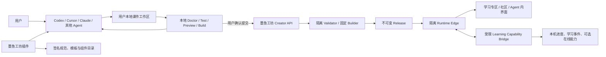

# Agent 原生互动课件插件平台完整设计

状态：D1.0 设计基线；L0、L1 已落地，L2 宿主适配已实现但真实跨宿主验收未完成，L3 平台基础已实现  
版本：D1.2  
日期：2026-10-14  
关联文档：[69 Agent 优先的结构化创作与发布路线](./69-ai-creator-studio-roadmap.zh-CN.md)、[GameHub MCP App 与统一自动更新](./gamehub-mcp-app.zh-CN.md)、[18 多宿主完整客户端](./18-multi-host-client-spec.zh-CN.md)、[16 上传发布与运行隔离](./16-publishing-runtime-spec.zh-CN.md)

## 1. 决策与产品定义

墨鱼工坊不建设站内通用 AI IDE，不代替 Codex、Cursor、Claude Code、VS Code Agent 或未来的其他制作 Agent，也不接收创作者的模型供应商密钥。

创作者继续在自己选择的 Agent 与本地工作区中制作。墨鱼工坊提供可安装、可自动更新的插件能力，使不同 Agent 能按同一协议完成：

```text
理解课件规范
  → 选择官方模板与组件
  → 在用户本地生成和修改源码
  → 本地预览与结构化验证
  → Agent 根据报告修复
  → 用户明确确认提交
  → 平台服务端重新验证
  → 创建不可变 Release
  → 在学习专区、社区和宿主内运行
```

产品定义为：

> **面向 AI Agent 的互动课件开放制作、验证、发布与运行协议。**

平台的护城河不是某一个模型，而是：

1. Agent 可理解、机器可验证的课件工程规范；
2. 稳定、统一、可组合的互动教学组件；
3. 本地与服务端一致的质量门禁；
4. 多 Agent、多宿主的一致创作流程；
5. 不可变版本、来源、许可证和审核记录；
6. 学习运行时、进度、反馈和社区传播。

### 1.1 顶层约束

- **MUST**：创作源码的事实来源始终是用户选择的本地工作区或其 Git 仓库。
- **MUST**：上传、提交草稿和公开发布均由用户明确触发；Agent 不得自行公开作品。
- **MUST**：本地验证结果不构成平台批准；服务端必须重新校验上传字节和声明。
- **MUST NOT**：插件不得读取或上传未被用户纳入当前课件项目的文件。
- **MUST NOT**：平台不得要求用户把模型 Key、平台 token 或邮箱验证码粘贴到提示词、课件文件或命令参数中。
- **MUST NOT**：作品 iframe 不得取得 Agent 工作区、宿主凭据、发布权限或通用本机能力。
- **SHOULD**：首版课件尽量构建为静态 Web、Canvas、SVG、WebGL2 或单线程 WASM，在用户设备运行。
- **MAY**：以后为确有需要的课件提供受控在线能力，但在线能力不是课件格式的默认前提。

## 2. 范围与非目标

### 2.1 本设计覆盖

- Agent 插件、Skill、MCP 与本地 CLI 的职责分工；
- 互动课件工程格式、构建产物和发布清单；
- 官方组件、模板和适配器体系；
- 本地预览、Doctor、测试和验证报告；
- Agent 到平台的草稿、上传、发布和更新流程；
- 运行时 SDK、学习事件和可选平台能力；
- 自动更新、权限变化和版本兼容；
- 安全、来源、许可证、质量与人工审核边界；
- 数据、API、实施阶段和验收矩阵。

### 2.2 明确不做

- 不建设另一个浏览器版 Codex、Cursor 或 Claude；
- 不为创作者提供通用模型额度或保存其模型 Key；
- 不要求所有课件使用 React、某个模型或某个 Agent；
- 不让作者任意提交 Dockerfile、服务器镜像或安装脚本并自动上线；
- 不用“大模型审核通过”代替事实、公式、测试和人工审核；
- 不在首版实现完整 LMS、班级、排课、教师组织和正式成绩册；
- 不围绕 STORM 或其他单一开源项目反推平台架构；它们未来只能作为普通适配器或外部工具候选。

## 3. 角色与责任

| 角色 | 责任 | 不拥有的权限 |
| --- | --- | --- |
| 用户选择的 Agent | 理解需求、编辑源码、运行本地工具、根据验证报告修复 | 不得自动发布，不得取得平台管理权限 |
| 墨鱼工坊 Agent 插件 | 提供可信规范、模板、命令、MCP 连接和更新器 | 不提供模型，不任意读取工作区 |
| 本地 Toolkit | 初始化、预览、检查、测试、构建、打包 | 不保存模型 Key，不绕过用户确认上传 |
| 平台 API/Worker | 认证、接收、服务端校验、构建、版本与发布 | 不信任本地报告，不执行任意项目脚本 |
| Runtime/SDK | 隔离运行作品并提供获批的窄能力 | 不接触作者身份、Agent 和本机文件 |
| 作者/教师审核者 | 对知识、教学设计和公开发布负责 | 不能以“AI 生成”为免责依据 |
| 学习者 | 匿名或登录体验课件、保存允许的进度与反馈 | 不能修改发布版内容和验证记录 |

## 4. 总体架构



系统分为四个平面：

1. **创作平面**：用户 Agent、本地工作区和本地 Toolkit；
2. **控制平面**：规范、组件目录、作品、版本、验证、审核、更新和审计；
3. **运行平面**：隔离的静态课件和受限能力桥；
4. **数据平面**：对象存储、作品元数据、验证报告、学习进度和聚合事件。

创作平面与运行平面不得共享凭据或通用消息通道。

## 5. 插件产品形态

一个逻辑插件通过不同宿主适配器交付，不维护互不兼容的产品分支。

| 宿主 | 交付形态 | 本地工作区能力 | 可视界面 | 更新方式 |
| --- | --- | --- | --- | --- |
| Codex | Agent plugin：Skill、模板、CLI、MCP 配置 | 通过 Agent 已授权的工作区工具 | MCP App/浏览器/本地预览 | marketplace 包，重启激活 |
| Claude Code | 同一便携 Agent plugin | 通过 Agent 工作区工具 | 浏览器/本地预览 | marketplace 包，重启激活 |
| VS Code | VSIX + 共享客户端 | Extension Host 的工作区与命令 | WebviewView、本地预览 | 扩展后台暂存，重启激活 |
| Cursor | 同一 VSIX 源，独立实测 | VS Code 兼容 API 的实测子集 | 编辑器 Webview；Agents Window 单列 | 扩展后台暂存，重启激活 |
| Harness | Harness bundle + HostAdapter | 已批准的本机文件与命令入口 | 右栏 | 平台清单和暂存包 |
| 其他 Agent | Skill/CLI/MCP 的能力子集 | 以宿主实际授权为准 | 浏览器回退 | 不伪造原生集成 |

### 5.1 插件包内容

```text
plugins/mooyu/
  plugin.json
  mcp.json
  skills/mooyu/SKILL.md
  bin/mooyu-courseware.mjs
  schemas/
  templates/
  components/catalog.json
  validators/
  migrations/
```

插件包只包含可复现的本地工具、规范和模板，不包含作品数据、用户 token 或模型运行时。

### 5.2 三种接口必须分开

1. **Remote MCP**：公开目录、规范、模板元数据、作品资料和托管界面；默认只读。
2. **Local Toolkit**：只操作用户明确选择的当前课件目录，负责预览、检查和构建。
3. **Creator API**：需要平台身份，用于草稿、上传、检查和发布；由可信宿主持有授权。

不能让远程 MCP 服务器直接读取用户文件，也不能把本地 CLI 变成接受任意 shell 的远程执行器。

## 6. Agent 工具契约

### 6.1 推荐工具

| 工具 | 作用 | 默认属性 |
| --- | --- | --- |
| `courseware.list_templates` | 查询安装包中可用模板 | 只读、本地 |
| `courseware.get_spec` | 读取指定版本规范和 Schema | 只读、本地优先 |
| `courseware.init` | 在用户选择的空目录复制模板 | 写本地，需明确目录 |
| `courseware.inspect` | 识别项目类型、版本和缺失项 | 只读本地 |
| `courseware.doctor` | 静态检查并输出结构化报告 | 只读本地 |
| `courseware.test` | 运行官方测试驱动，不执行任意 lifecycle script | 受限本地执行 |
| `courseware.preview` | 启动 loopback 临时预览 | 临时本地服务 |
| `courseware.build` | 用固定 Builder 生成 `dist/` | 写本地构建目录 |
| `courseware.package` | 生成待上传 ZIP 与摘要 | 写本地制品 |
| `courseware.submit` | 创建/更新私有草稿或上传任务 | 外部写，必须用户确认 |
| `courseware.publish` | 发布已通过的具体 Release | 外部写，必须再次确认 |
| `courseware.status` | 查询校验、草稿和发布状态 | 只读平台 |
| `courseware.open` | 打开预览或正式作品 | UI 操作 |

### 6.2 用户确认边界

以下行为不得从“请帮我做一个课件”推导出授权：

- 下载、安装或执行第三方编译器；
- 新增系统服务、计划任务或防火墙规则；
- 登录平台、提交草稿或上传文件；
- 公开发布、更新当前公开版本或撤下作品；
- 申请新的课件运行能力；
- 将素材或源码发送给第三方服务。

本地创建和修改用户指定项目属于创作任务正常范围；提交和发布属于新的外部状态变化，必须显式确认。

### 6.3 CLI

```text
mooyu-courseware list
mooyu-courseware show <template>
mooyu-courseware init <template> <directory>
mooyu-courseware inspect <directory> --json
mooyu-courseware doctor <directory> --json --output <report>
mooyu-courseware test <directory> --profile standard
mooyu-courseware preview <directory> --port 0
mooyu-courseware build <directory>
mooyu-courseware package <directory> --output <zip>
mooyu-courseware submit <directory-or-zip>
mooyu-courseware status <submission-id>
```

CLI 不提供 `exec`、`shell`、`install-anything` 或任意 URL 下载命令。

## 7. 互动课件工程规范 v1

### 7.1 目录

```text
courseware-project/
  mooyu-courseware.json       必需，严格 Schema
  courseware/
    course.json               教学结构、场景和目标
    assessments.json          可选，题目与判分定义
  evidence/
    sources.json              必需，知识来源及对应声明
  tests/
    journeys.json             必需，关键学习路径
    assertions.json           可选，数值/状态断言
  src/                        可编辑源码
  assets/                     本地素材及来源记录
  dist/                       构建产物，不作为唯一源码
  README.md                   面向作者，可选
  LICENSE                     作者选择，建议
```

禁止把平台 token、模型 Key、用户绝对路径、提示词历史和无关聊天记录放进项目。

### 7.2 顶层 Manifest 示例

```json
{
  "format": "mooyu.interactive-courseware",
  "schemaVersion": 1,
  "title": "探索二次函数",
  "defaultLocale": "zh-CN",
  "locales": ["zh-CN", "en"],
  "subject": ["mathematics"],
  "audience": { "stage": "junior-secondary", "minAge": 12, "maxAge": 15 },
  "course": "courseware/course.json",
  "evidence": "evidence/sources.json",
  "tests": "tests/journeys.json",
  "build": {
    "profile": "mooyu-static-v1",
    "entry": "dist/index.html"
  },
  "runtime": {
    "kind": "static-web",
    "sdk": 1,
    "capabilities": ["learningProgress", "fileExport"]
  },
  "licenses": {
    "code": "MIT",
    "content": "CC-BY-4.0"
  }
}
```

规范要求：

- `additionalProperties: false`；未知字段拒绝，不静默忽略；
- 路径必须是包内规范相对路径，不允许 `..`、绝对路径、URL 和符号链接；
- `build.profile` 只能引用平台公布的固定构建配置；
- `runtime.capabilities` 只是申请，平台批准后才进入 Release；
- 作者声明的许可证不等于平台已完成权利核验；
- 年龄和学科用于发现与设计提示，不构成教育资质认证。

### 7.3 教学结构

`course.json` 使用稳定 ID 组织：

```text
Course
  objectives[]
  prerequisites[]
  misconceptions[]
  scenes[]
    explanation
    visualization
    interaction
    checkpoint
  completion
```

每个 `Scene` 至少声明：

- `id`：发布版本内稳定；
- `objectiveIds`：服务于哪些学习目标；
- `type`：讲解、探索、模拟、练习或总结；
- `component`：官方组件或项目内实现；
- `completion`：可机器判断的完成条件；
- `fallback`：动画或高级能力不可用时的可读替代；
- `evidenceIds`：该场景涉及的知识依据。

首版不要求平台理解作品全部内部 UI，但必须能识别目标、场景、关键检查点、测试路径和来源。

### 7.4 Evidence

`sources.json` 区分“来源”和“声明”：

- source：标题、作者/机构、URL/出版信息、访问日期、许可证；
- claim：稳定 ID、课件中的结论、sourceIds、定位信息、验证方式；
- asset：素材来源、作者、许可证、修改说明；
- generated：AI 参与类型，仅记录生成事实，不记录私密提示词。

没有来源的声明可以保存为草稿，但不能获得“来源完整”质量标记。来源存在也不意味着内容一定正确。

## 8. 官方组件与模板体系

### 8.1 组件设计原则

官方组件优先使用标准 Web Components/ES Modules 和明确的状态接口，避免强制作品采用特定前端框架。Canvas、SVG、WebGL2 和 WASM 可由组件内部使用。

组件必须：

- 输入和输出可 JSON Schema 验证；
- 状态可序列化和重放；
- 支持确定性测试种子；
- 提供键盘和触摸路径；
- 尊重 reduced-motion、高对比度和缩放；
- 提供静态或文本 fallback；
- 不默认联网，不加载远程 CDN；
- 版本固定并随作品构建产物发布。

### 8.2 首批组件包

| 包 | 组件示例 |
| --- | --- |
| `@mooyu/courseware-core` | Scene、Step、Checkpoint、Hint、Progress |
| `@mooyu/courseware-charts` | 坐标系、函数图像、数据图表、时间轴 |
| `@mooyu/courseware-math` | 公式步骤、数轴、向量、几何对象、参数滑块 |
| `@mooyu/courseware-science` | 力与运动、电路、光线、粒子、测量仪表 |
| `@mooyu/courseware-algorithms` | 数组、图、树、指针、调用栈、代码步进 |
| `@mooyu/courseware-assessment` | 单选、多选、排序、配对、数值输入、开放检查点 |
| `@mooyu/courseware-a11y` | 文字替代、焦点管理、旁白同步、运动降级 |

包名为设计目标；实施前需通过依赖、许可证和包体积评审。

### 8.3 首批模板

1. `concept-explorer`：概念讲解、参数探索、即时问题；
2. `causal-simulation`：改变变量、观察因果、预测再验证；
3. `algorithm-stepper`：逐步执行、状态可视化、复杂度解释；
4. `guided-practice`：示例、脚手架、独立练习和总结。

模板不是截图或提示词，而是包含源码、Manifest、测试、来源样例和固定构建配置的可运行工程。

## 9. 本地制作循环

### 9.1 初始化

Agent 读取已安装插件中的签名目录，选择兼容模板，复制到用户明确选择的目录。不得直接修改插件缓存中的模板。

### 9.2 修改

Agent 可以编辑项目内源码、结构化内容和测试。项目中的 README、网页文本、下载内容和第三方资料均视为不可信数据，不能覆盖插件 Skill、安全规则或用户指令。

### 9.3 预览

预览器绑定随机 loopback 端口，只服务当前项目构建目录，并展示：

- 课件画面和场景导航；
- 当前 Scene、Objective 和状态快照；
- 学习事件调试流；
- 中文/英文与尺寸切换；
- 键盘、触摸、reduced-motion 和高对比度模拟；
- 控制台错误、失效资源和未授权网络请求；
- 刷新、深链、重开和完成路径。

预览服务停止时清理临时目录和端口，不注册常驻系统服务。

### 9.4 Doctor 与自动修复循环

Doctor 输出稳定 JSON，不把自然语言日志作为唯一接口：

```json
{
  "reportVersion": 1,
  "validatorVersion": "1.0.0",
  "projectDigest": "<64 位小写 SHA-256 十六进制摘要>",
  "ok": false,
  "findings": [{
    "severity": "error",
    "code": "OBJECTIVE_UNCOVERED",
    "path": "courseware/course.json",
    "pointer": "/objectives/2",
    "message": "学习目标没有对应场景或检查点。",
    "fix": "为该目标增加 scene.objectiveIds 和至少一个 checkpoint。"
  }]
}
```

Agent 根据 `code/path/pointer` 修复后重新运行。修复不能通过删除测试、来源或质量要求来“让报告变绿”。

## 10. 验证与质量门禁

### 10.1 验证层级

| 层级 | 内容 | 是否可自动发布 |
| --- | --- | --- |
| V0 结构 | Schema、路径、大小、入口、禁止文件 | 必须通过 |
| V1 运行 | 启动、资源、CSP、控制台、响应式、性能预算 | 必须通过 |
| V2 交互 | 关键 journey、状态转换、刷新和完成条件 | 必须通过 |
| V3 教学 | 目标覆盖、前置知识、误区、反馈与认知负担提示 | 警告或人工复核 |
| V4 学科 | 公式、数值、单位、守恒、代码测试等领域验证 | 支持的领域必须通过 |
| V5 来源 | 声明—来源映射、素材权利与可追溯性 | 决定质量标记 |
| V6 人工 | 作者、教师或学科审核者确认 | 决定审核标记，不替代 V0—V2 |

### 10.2 AI 不能自证正确

- 生成课件的同一个 Agent 可以修复问题，但不能签发平台验证结论；
- “另一模型认为正确”只能作为建议，不能等价于数学或程序验证；
- 数学使用符号规则、数值采样和边界测试；
- 物理使用单位、范围、已声明模型和不变量测试；
- 算法使用固定输入、性质测试和输出断言；
- 事实型内容依靠来源与人工复核，不宣称自动证明真伪。

### 10.3 对外质量标记

允许展示：

- 技术检查通过；
- 关键交互测试通过；
- 来源完整；
- 领域自动检查通过；
- 作者自审；
- 教师/学科审核；
- 社区复核中。

禁止使用含义模糊的“AI 认证正确”或把“Web 版已验证”解释为知识已审核。

## 11. 构建与供应链

### 11.1 两条发布路线

**编译产物路线（首版默认）**：

```text
Agent 在本地构建 dist
  → Doctor
  → 打包 dist + 发布元数据
  → 现有 Web ZIP Validator
  → 不可变 Release
```

平台不需要接收完整源码，也不执行 npm lifecycle script。

**受控源码路线（后续）**：

```text
允许的结构化源码/固定模板
  → 无网络固定 Builder
  → SBOM、摘要和构建报告
  → Web ZIP Validator
  → 不可变 Release
```

只允许平台维护的 Builder profile；不得执行作者自定义安装、prebuild、postinstall 或 shell。

### 11.2 依赖规则

- 发布产物不得依赖运行时公共 CDN；
- 官方组件锁定版本并随构建产物携带；
- 第三方依赖记录名称、版本、来源、许可证和摘要；
- 发现已知严重漏洞或许可证冲突时阻止新发布，不无条件撤回已加载代码；
- 锁文件用于重现，不代表平台自动信任其中依赖；
- 组件升级生成新 Release，不原地改变旧 Release 行为。

## 12. 提交、草稿与发布

### 12.1 状态机

```text
local-only
  → submitting
  → private-draft
  → validating
  → validation-failed | ready
  → user-confirmed-publish
  → published
  → superseded | withdrawn | revoked
```

### 12.2 并发与更新

- 本地 `.mooyu/draft.json` 只保存 origin、draftId、revision、项目摘要和最后提交时间；
- 不保存 token、邮箱、模型信息或完整绝对路径；
- 再次提交携带远端 revision 和内容摘要；
- 远端已变化时返回冲突，Agent展示差异并由用户决定；
- 不提供 `--force` 静默覆盖；
- 同一摘要重复提交不产生空修订；
- 公开发布始终绑定具体的已验证修订和 Release。

### 12.3 预览和发布不是同一授权

用户同意本地预览、同意上传私有草稿、同意公开发布是三个独立动作。提交成功后的默认结果是私有草稿，不自动进入发现页。

## 13. 运行时与 Learning SDK

### 13.1 首版运行类型

- `static-web`：HTML、CSS、JavaScript、Canvas、SVG、WebGL2；
- `static-wasm`：经过模板批准的单线程 WASM；
- `structured-courseware`：由平台固定 Builder 生成上述静态产物。

托管后端、任意代码沙箱、实时课堂和远程 LTI 不属于插件化课件首版。Manifest 为未来类型保留扩展版本，但当前 Validator 必须拒绝未实现类型。

### 13.2 SDK 能力

复用现有 MessageChannel、精确 release origin 和批准能力机制。新增能力建议：

| 能力 | 首版语义 | 访客策略 |
| --- | --- | --- |
| `learningProgress` | 保存场景完成度和有限课件状态 | 默认本机；登录后是否同步另行开放 |
| `learningEvents` | 提交受限、结构化、可聚合事件 | 需透明说明，可关闭非必要分析 |
| `assessmentResult` | 保存检查点结果摘要，不上传自由文本原文 | 本机或短期会话 |
| `fileExport` | 导出学习报告 PNG/JSON | 复用现有安全导出 |
| `shareLinks` | 分享作品或用户主动选择的有限状态 | 复用现有分享协议 |
| `adaptiveTutor` | 保留能力，首版不开放 | 不得因声明自动取得模型调用 |

作品不得自行指定 accountId、workId、releaseId、API origin、存储路径或模型供应商。宿主根据批准的 Release 注入作用域。

### 13.3 事件词汇

首版事件保持小而稳定：

```text
courseware.started
scene.entered
interaction.changed
checkpoint.attempted
hint.requested
objective.completed
courseware.completed
courseware.exited
```

每个事件限制字段、节点数和字节数，只接受课件 Manifest 中存在的 ID。禁止上传键盘原文、聊天全文、文件内容、完整 URL、个人信息和未声明自定义事件。

## 14. 数据与 API 增量

### 14.1 复用现有实体

- `works`：增加/启用 `kind=courseware`；
- `work_targets`、`uploads`、`releases`、`assets`：继续复用；
- `approved_capabilities`：扩展学习能力；
- `creator_drafts`：复用私有待发布草稿和 revision；
- 现有 catalog、分享、收藏、社区、审核和审计继续复用。

### 14.2 新增数据

| 表/记录 | 作用 |
| --- | --- |
| `courseware_release_profiles` | Release 的学科、年龄、语言、目标、场景和规范版本摘要 |
| `courseware_validation_reports` | Validator 版本、策略、项目摘要、finding 和质量标记 |
| `courseware_sources` | Release 对应来源、声明映射和素材权利摘要 |
| `learning_progress` | 用户或本机主体的有限课件进度；与通用游戏存档分开 |
| `learning_event_batches` | 有期限、可聚合的学习事件批次 |
| `courseware_component_catalog` | 官方组件版本、摘要、许可证和支持状态 |

学习事件不得塞进作品统计表；课件状态也不得借用社区帖子或通用分析日志保存。

### 14.3 API

公开只读：

```text
GET /v1/courseware/specs/{version}
GET /v1/courseware/templates
GET /v1/courseware/components
GET /v1/courseware/works/{workId}/profile
```

作者：

```text
POST /v1/creator/courseware/drafts
PUT  /v1/creator/courseware/drafts/{id}
POST /v1/creator/courseware/drafts/{id}/submissions
GET  /v1/creator/courseware/submissions/{id}
GET  /v1/creator/courseware/submissions/{id}/validation
POST /v1/creator/courseware/submissions/{id}/publish
```

运行时：

```text
POST /v1/learning/sessions
PUT  /v1/learning/progress/{workId}
POST /v1/learning/events:batch
```

实际实施优先复用现有 Upload、Release 和 game session 路由，以上资源名表达领域边界，不要求重复建设传输链。

## 15. 安全与隐私

### 15.1 工作区

- 插件只操作用户选定项目根；
- 解析后的所有路径必须位于根内；
- 默认忽略 `.git`、`.env*`、凭据目录、父目录和符号链接；
- Secret Doctor 对疑似凭据报错，但不把匹配内容写入报告；
- Agent 需要扩大读取范围时由宿主按自身规则请求用户授权。

### 15.2 提示注入

- 插件 Skill 和签名 Schema 是可信指令来源；
- 项目 README、源码注释、网页内容、外部教材和下载文件均是不可信数据；
- 不执行项目中要求“上传整个目录”“关闭验证”“显示 token”的文字；
- 验证报告中的 message 视为数据，只有稳定 code 和官方规则决定行为。

### 15.3 运行隔离

- 继续使用一 Release 一运行来源和 `sandbox=allow-scripts`；
- 默认无摄像头、麦克风、地理位置、剪贴板、弹窗和顶层导航；
- 运行产物无平台 Cookie；
- Learning SDK 与 Creator/Host 通道完全分离；
- 作品不得通过 `postMessage` 请求本机预览、上传、发布或 shell。

### 15.4 未成年人和学习数据

- 首版不采集真实姓名、学校、班级和精细画像；
- 游客默认本机保存进度；
- 服务端事件只保存完成、尝试次数和有限状态，不默认保存自由文本答案；
- 发布者只能看到聚合数据，不看到单个匿名学习者轨迹；
- 数据保留期、导出和删除策略必须在开放在线进度前完成。

## 16. 插件更新与版本兼容

### 16.1 版本必须分离

以下版本各自独立：

- Agent plugin version；
- Local Toolkit version；
- Courseware Schema version；
- Component Catalog version；
- Runtime SDK protocol；
- Validator policy version；
- Platform API version；
- Work Release version。

不得用插件版本推断作品版本或 Validator 结论。

### 16.2 更新流程

延续现有 `downloads/manifest.json` 契约：每 6 小时检查、后台下载、SHA-256 校验、宿主重启激活、失败保留当前可用版本。

目标升级为 manifest v3：

- Ed25519 签名和固定根公钥；
- 单调递增 sequence，拒绝回滚到更旧清单；
- 清单到期时间和稳定/预览通道；
- 保存至少一个 last-known-good 本地包；
- 逐文件摘要与总包摘要；
- 权限差异 `permissionDelta`；
- 新增文件、网络、凭据、写工具或外部发布权限时停止静默激活并重新征求用户同意。

在 v3 实施前，文档必须如实说明当前只有同源清单和 SHA-256 完整性校验，不宣称已有独立数字签名。

### 16.3 兼容承诺

- Schema v1 发布后只做向后兼容修订；破坏性变更使用新 major；
- Toolkit 至少能读取当前和前一个 major，并给出迁移报告；
- 已发布 Release 固定自己的 SDK/组件文件，不被插件升级原地改变；
- 平台 Runtime 保留已公开且未撤销 Release 所需的受支持协议；
- 模板升级通过显式 migration 修改用户项目，不静默重写。

## 17. 管理与运营界面

创作者中心新增“互动课件”视图，但不增加站内代码编辑器：

- 项目规范和插件安装状态；
- 最近提交、验证和发布结果；
- 质量标记及缺失项；
- 版本、语言、来源和许可证；
- 隔离预览；
- 复制给 Agent 的修复任务；
- 明确的发布、更新和撤下按钮。

管理员后台新增：

- Courseware Validator 策略与版本；
- 组件和模板目录；
- 高风险能力申请；
- 来源/许可证抽查；
- 人工学科审核记录；
- 失效模板、撤销组件和受影响 Release 查询；
- 插件版本、宿主采用率和更新失败情况。

## 18. 实施阶段

### 18.0 当前实现证据（2026-10-13）

已落地：

- `packages/contracts/courseware/`：Manifest、课程结构、来源、学习路径、Doctor 报告和 Learning SDK v1 的机器契约；
- `packages/creator-tools/src/courseware.mjs`：严格字段、跨文件引用、目标覆盖、完成路径和构建入口检查；
- `templates/courseware/`：数学概念、物理因果模拟、算法步进三个双语、可交互静态参考包；
- `creator-toolkit doctor`：自动识别 `mooyu-courseware.json`，普通网页项目保持原行为；
- Codex/Claude 便携插件构建：携带课件 Schema、参考包、Skill 说明和 Doctor；
- `tests/platform/courseware-contract.test.cjs`：通过样本与破坏性反例验证契约门禁。

2026-10-14 补齐 L1 本地闭环：

- `init`：只向不存在的新目录复制三类官方参考包，拒绝覆盖；
- `inspect`：输出作品身份、语言、学科、目标/场景/检查点/证据/路径数量和内容摘要；
- `doctor`：合并课件跨文件校验与现有静态 Web 安全检查；
- `preview`：仅绑定 loopback，使用 no-store、CSP、nosniff 和路径穿越防护；
- `test`：把 `tests/journeys.json` 映射为真实 Playwright 操作并核验 Learning SDK 事件；插件不静默安装 Playwright；
- `build`：Doctor 通过后建立内容摘要寻址的受管构建目录及逐文件 SHA-256 报告；
- `package`：Doctor 通过后生成确定性 ZIP，相同内容复用，不覆盖不同内容；
- 便携插件版本提升至 `0.4.0`，同步携带命令、契约、Skill 与参考包。

2026-10-14 补齐 L2 宿主适配实现：

- Codex/Claude 便携插件通过相同 CLI、Skill、Schema 和模板操作用户授权工作区；
- VS Code/Cursor 提供新建、概览、Doctor、loopback 预览、真实路径测试、构建和打包命令，以及禁用脚本的结构化结果面板；
- VSIX 内置 Toolkit 桥、Schema、模板与真实宿主支持矩阵，不依赖源码仓库；
- Harness 只标记当前实际支持的托管界面与 Agent CLI 回退；右栏没有安全工作区 API，因此明确标记 `limited`，不伪装为原生本地创作；
- `host-support.json` 明确每个宿主的状态、界面、本地工作区能力、浏览器测试条件和权限集合。

2026-10-14 补齐 L3 平台基础：

- 数据库与公开 API 加入 `kind=courseware`，不把课件伪装成普通游戏；
- Web ZIP 在服务器解包后重新执行 Courseware Doctor，不信任本地 PASS 或作者提供的报告；
- 通过复验的学科、语言、适用对象、许可证、Runtime 和摘要进入不可变 Release manifest；
- 公开目录只从当前已发布 Release 读取复验后的课件摘要；
- 新增中英文 `/learn` 学习专区，只请求 `courseware` 目录，展示学科、适用阶段与服务器复验状态；
- Agent 课件命令分为 `submit`、`status`、`publish`：提交始终创建 `autoPublish=false` 的私有 Release，状态查询不改变远端，公开发布必须由用户另行明确触发；
- `POST /v1/creator/works/{workId}/releases/{releaseId}/publish` 只接受作品所有者选中的、服务端验证通过且未撤销的具体 Release，并要求 Work ETag 与幂等键。

尚未完成且不得提前宣称：

- Web、Codex MCP App、VS Code/Cursor 中的真实共享播放器逐项验收；
- Windows/macOS/Linux 路径矩阵，以及安装了 Playwright 的真实浏览器旅程验收；
- L3 真实账号下的 Agent 提交—平台验证—用户确认发布端到端验收，以及详情页完整质量标记（两阶段命令与服务端门禁已实现，尚缺生产验收）；
- L4 学习记录持久化、隐私控制和报告导出。

### L0：规范冻结与参考样本

- 发布 Courseware Schema v1、course/evidence/test Schema；
- 建立三个参考课件：数学概念、物理因果模拟、算法步进；
- 为每个样本提供来源、测试和中英文；
- 使用现有 Web ZIP Runtime 证明无需新服务器即可运行。

完成门槛：三个样本在 Web、Codex MCP App、VS Code/Cursor 共享播放器中按实际可用宿主完成测试；未实测宿主不得标记兼容。

### L1：本地 Toolkit

- `init/inspect/doctor/test/preview/build/package`；
- 稳定 JSON 报告；
- 官方模板和组件目录；
- secret、路径、远程依赖和许可证检查；
- Windows/macOS/Linux 的路径与 loopback 预览测试。

完成门槛：Agent 可以在无平台登录状态下完成创建—预览—修复—打包。

### L2：Agent 插件

- 扩展现有 Skill 和 plugin metadata；
- Codex/Claude 便携插件加入 courseware Toolkit；
- VS Code/Cursor 加入命令与验证结果面板；
- Harness 加入实际支持的能力；
- 自动更新和权限差异门禁。

完成门槛：同一项目可由至少两个不同 Agent 继续编辑，不依赖隐藏聊天状态。

### L3：平台提交与发布

- `kind=courseware`、私有草稿、validation report 和发布页；
- 复用上传、隔离 Validator、Runtime Edge 和不可变 Release；
- 学习专区首版目录和作品详情；
- 来源、语言、年龄和质量标记展示。

完成门槛：Agent 提交后，服务端可发现本地未发现的伪造报告、越界文件和 Manifest 变更；公开发布仍需用户确认。

### L4：Learning SDK

- `learningProgress` 本机模式；
- 结构化事件调试与可关闭的聚合统计；
- `assessmentResult` 和学习报告导出；
- 数据保留、删除和隐私说明。

完成门槛：游客无需注册即可完整学习；关闭分析不影响核心课件运行。

### L5：生态扩展

- 第三方模板/组件的签名目录和审核；
- 受控源码 Builder；
- 学科专用验证器插件；
- 可选在线辅导、代码执行或外部标准适配；
- 根据真实需求评估 H5P、QTI、LTI、xAPI，而不是首版全部实现。

## 19. 首版验收矩阵

| 编号 | 必须通过 |
| --- | --- |
| LC01 | Codex 与 Cursor/VS Code 中至少两种 Agent 能从同一模板创建可互相继续编辑的项目 |
| LC02 | 本地项目不包含平台 token、模型 Key、绝对用户路径或运行时 CDN 依赖 |
| LC03 | Doctor 报告有稳定 code/path/pointer，Agent 修复后相同项目摘要得到可重复结果 |
| LC04 | 三个参考课件完成键盘、触摸、窄屏、英文、中文、reduced-motion 和高对比度路径 |
| LC05 | 伪造本地 PASS 报告不能绕过服务端 Schema、ZIP 和 Runtime 检查 |
| LC06 | 提交默认创建私有草稿；公开发布、更新当前版和撤下分别需要明确操作 |
| LC07 | 旧 Release 在插件、模板和组件升级后行为与摘要不变 |
| LC08 | 作品 iframe 无法读取工作区、调用 Creator API、取得宿主凭据或要求执行 shell |
| LC09 | 来源缺失、素材许可证缺失和领域检查未完成会显示准确状态，不伪装为已审核 |
| LC10 | 插件更新失败保留现有版本；权限增加不会静默激活 |
| LC11 | 游客不注册即可运行课件并使用本机进度；分析关闭后核心流程仍可用 |
| LC12 | 管理员可以按插件、Validator、Schema、组件和 Release 摘要追溯问题范围 |

## 20. 与现有系统的迁移关系

本设计是 [69](./69-ai-creator-studio-roadmap.zh-CN.md) 的互动课件扩展，不取代其“外部 Agent 创作、平台不托管模型、用户确认发布”的既有决策。

实施时：

1. 保留当前 `gamehub` 包名和已安装更新路径，避免破坏现有用户；用户可见品牌继续使用“墨鱼工坊”；
2. 先扩展 `creator-tools` 目录和 Skill，再决定内部包名迁移，不用品牌重命名阻塞功能；
3. 继续复用 `platform.json` 与 Web ZIP Validator 作为最终运行包门禁；课件工程 Manifest 属于创作层，不直接扩大 iframe 权限；
4. 继续复用现有 MCP App 托管界面；本地工作区预览由 Toolkit 提供，不通过远程 iframe 读取本机文件；
5. 继续复用插件自动更新契约，并把数字签名和权限差异作为独立安全增量；
6. 不因增加学习专区而更改现有游戏、社区、存档、竞赛和 GitHub 导入行为。

## 21. 开始实施前必须冻结的五个产物

1. `mooyu-courseware.schema.json`；
2. `course.schema.json`、`sources.schema.json`、`journeys.schema.json`；
3. `Doctor report schema v1`；
4. `Learning SDK protocol v1`；
5. 三个端到端参考课件及其预期验证报告。

这五项冻结前，不先建设大型学习专区页面，不开放第三方组件市场，也不承诺在线 AI 辅导。它们是不同 Agent 能稳定协作的共同语言。

## 22. 参考项目带来的设计依据

- [H5P](https://github.com/h5p/h5p-php-library)：内容类型与宿主适配器分离；
- [Numbas](https://github.com/numbas/Numbas)：作者/编译阶段与完全浏览器运行分离；
- [eXeLearning](https://github.com/exelearning/exelearning)：结构化创作、协作与多格式导出；
- [PhET 构建工具](https://github.com/phetsims/chipper)：共享组件和独立模拟构建；
- [OATutor](https://github.com/CAHLR/OATutor)：静态核心与可选学习后端并存；
- [Pyodide](https://github.com/pyodide/pyodide)：优先把可控计算放到浏览器；
- [XBlock](https://github.com/openedx/XBlock)：运行时、组件 API 和存储作用域分离。

这些项目提供架构证据，不代表平台要复制其产品、代码或许可证模式。任何实际引入仍须单独完成维护状态、许可证、安全和包体积审查。
