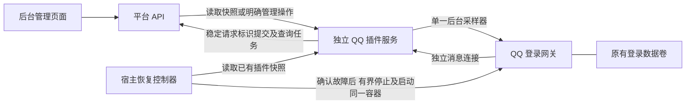

# QQ 独立插件稳定性改造：本地实现与验收

本阶段目标是让普通功能更新与 QQ 登录、消息连接、恢复动作分开管理。本地实现和故障模拟已完成；尚未部署到服务器，也未安装或启用恢复控制器。不能据此宣称服务器已经具备新行为。

本次没有连接生产服务器、修改线上配置、重启线上服务、请求真实 QQ 登录、重试历史任务或操作旧锁定记录。两套论文系统的关闭配置未改动。原 GitHub 修复及历史发布文件继续保留。

## 运行边界

QQ 服务本来已有独立容器和插件清单。本次修正运行与状态管理的耦合，没有重建一套账号、授权、预算或任务系统。恢复控制器放在宿主机，QQ worker 不获得 Docker socket 或容器管理权限。

## 本地实现

### 状态观察与业务门禁

- `control-server.mjs` 的 status 操作只读插件快照，不再调用原生 inspect、登录或写连接配置。
- `plugins/qq/runtime.mjs` 使用单一后台采样器，独立于平台任务处理循环；平台 API 请求等待时，原生状态采样仍可推进。关闭插件会停止后续采样与配置修复。
- `NapCatControl` 合并同一账号/群的并发采样；不同配置使用代际保护，旧请求的迟到结果不能覆盖新配置状态。
- 每轮原生读取使用 8 秒总预算，共享已有管理鉴权客户端及限流冷却；不为页面请求创建新的 NapCat 管理客户端。
- 快照版本为 2，区分状态是否可查询、原生登录、账号匹配、群成员关系、消息连接，以及 checkedAt/verifiedAt 和 unknown/partial/stale 状态。
- 临时读取失败不会凭空改写为退出登录。此前成功核验的业务状态最多保留 30 秒；超时停止业务。明确退出、账号不符、群成员失效立即关闭门禁，新群不能继承旧群的就绪状态。
- 成员详情接口不可用时，仍使用此前本地完成的同账号群列表回退；不会仅凭 WebSocket 连通或群信息可见放行。

### 消息连接与后台界面

- 连接断开后先留出 15 秒重连宽限；已有受管配置相同时不再重复写入。
- 确实需要修改时只更新受管条目，保留未知设置；发现启用的人工连接配置则不接管。不确定的配置写入指数退避，最多 5 分钟。
- API 管理查询失败只标注“状态查询中断”，不改写已知的原生登录和连接字段；未知账号/群状态不再误报账号不符或要求重新入群。
- 两块后台面板使用同一状态解释函数。状态未知但管理接口可访问时，仍提供“检查并获取登录二维码”，由服务端实时检查是否已登录。已登录时拒绝再次登录；权限撤销时清除二维码、密码及管理表单。
- 原密码登录、扫码、二维码刷新、CAS 管理版本、签名、限流与敏感信息清理继续保留。二维码只在浏览器内存中显示，不保存到本地存储。
- 平台 API 暂停时，原有 QQ 任务通过已有桥接逻辑延后，并沿用持久请求标识；不新增旧任务重试入口，不自动重发结果不确定的消息。

### 有界恢复

`recovery-policy.mjs` 与 `scripts/qq-plugin-guardian.mjs` 已在本地实现：

1. 仅对新鲜快照中明确报告的原生登录恢复失败采取动作。至少 3 个不同采样、持续至少 60 秒；普通等待扫码、API/管理查询失败、账号已经登录、群状态失败均不触发网关重启。
2. 相同故障只处理一次；需要连续健康 10 分钟才重新允许处理新故障。两次尝试至少间隔 15 分钟，滚动 24 小时最多 2 次。次数在外部动作前持久化，异常或时钟回退进入复核。
3. 固定同一网关容器 ID、镜像、完整配置、登录卷、账号和群。要求现有多进程恢复模式，身份漂移就拒绝；不会重建网关或更换登录卷。
4. 共用发布维护互斥目录，并用 OS flock 串行化守护器。只回收已证明死亡、且属于本守护器的遗留租约；旧发布或未知锁原样保留。
5. 确认没有正在发送的消息后，备份并完整读取校验登录归档，再停止同一网关；停机备份完成后启动同一容器。停机备份校验失败也会尝试启动原容器，随后进入复核。
6. 对“已经发出停止、尚未完成启动”的中断，持久记录允许一次只启动的补偿；核对相同容器和既有已校验备份，不再重复停止。再次失败转人工复核。
7. 控制器通过 worker 已有签名控制接口读取快照，绕开网站 API；不创建第二个 NapCat 管理登录、不自动请求密码或二维码、不恢复数据库、不清空登录数据、不操作其他服务。

`deploy/qq/independent-plugin/` 提供默认禁用且必须填写精确身份的配置示例和 systemd 模板，尚未安装。故障无法确认、备份失败或次数用尽时保持复核状态；不承诺对腾讯限制、网络故障或未知原生错误无限重启就能恢复。

### 发布保护

`qq-plugin-release-guard.mjs`、`integrate-qq-release-guard.mjs` 已接入未来 GitHub 发布文件生成器。新生成的更新器在停止任何服务前，要求 QQ v2 新鲜快照中的登录、账号、群、消息连接全部正常；旧 worker 的不完整状态不能冒充通过。

更新后每 10 秒读取一次新快照，共 40 秒，检查采样时间持续推进及原有受保护容器不变。基线已有故障时在变更前拒绝；后置失败时不能写出成功回执，也不会自动重启 QQ 掩盖问题。检测窗口内采样正常不等于证明窗口外永不掉线。

旧发布归档和服务器锁定记录未重写。门禁集成只影响将来新生成的发布文件。直接手工绕过发布工具执行任意 Docker 命令，不在该门禁的保障范围内。

## 验收证据

最终证据目录：`E:\CodexData\build\Right\agent-server-preflight\20261124\qq-plugin-stability-local-r3`。

| 验收 | 结果 | 范围 |
| --- | --- | --- |
| 本机通道、状态、鉴权、扫码、插件及故障注入回归 | 67/67 通过 | 真实回环 HTTP/OneBot；原生和模型响应为模拟 |
| Linux 与隔离 PostgreSQL | 50/50 通过 | 真实数据库、签名控制、CAS、权限/预算/历史保留；守护器使用真实私有文件/归档，Docker 动作为模拟 |
| 最后变更及发布/回退生成复核 | 29/29 通过 | v2 完整基线、40 秒门禁、恢复策略；包括已存在的 Bash 回退语法检查 |
| Edge 桌面与手机后台测试 | 2/2 通过 | 状态中断、账号/群未知、扫码入口、敏感信息清理、管理权限撤销、原设置行为及无横向溢出 |

这些测试组存在重叠，不累加为不同功能数量。Linux 测试复用既有镜像中的依赖，仅补充已有 QQ 镜像的 ws 包，应用源码只读挂载；不是已发布的业务候选镜像。新测试数据库位于无外部网络的临时容器，验收后删除本次创建的容器。

早期失败记录保留：首轮隔离验收的数据库名/依赖布局不符合测试约束，已修正测试环境；本机 Bash 与回环受沙箱限制的检查在获准的本地执行范围内通过；旧 Playwright 缓存不完整，最终使用独立 E 盘工具目录与系统 Edge。没有降低断言或跳过必要测试。

## 未来上线边界

一次基础升级需要配套发布 QQ worker、状态聚合 API 和后台页面；恢复控制器另行安装和明确启用。当前已修复多进程模式的网关可继续使用原容器、镜像和登录卷，不能把旧单文件群检查包当成本轮完整改造包。

之后 GitHub 功能更新可以继续只更新其 API/执行器，并使用新的 QQ 应用层门禁。实际生产扫码、QQ 收发和恢复窗口验收仍须在后续明确的发布阶段完成。本地结果不是腾讯登录成功的替代证明，也不授权现在重启任何线上服务。
