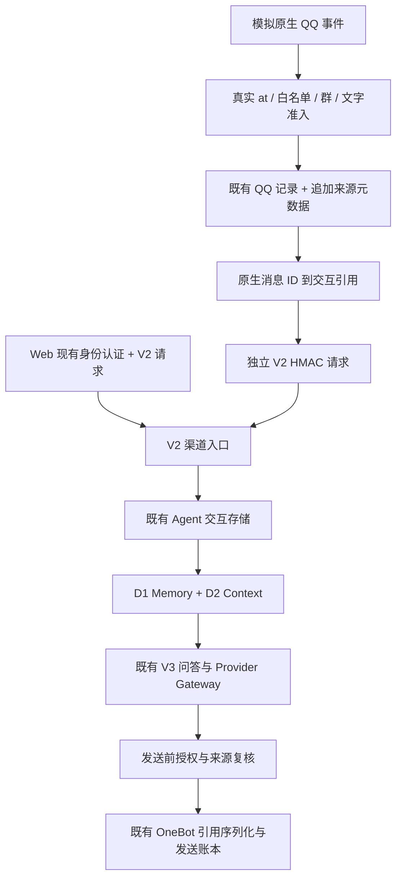

# 小墨鱼 D2 渠道入口：本地引用闭环

日期：2026-11-28。承接 [统一架构](xiaomoyu-unified-memory-and-tools-architecture-20261128.zh-CN.md)、[D1 只读记忆](xiaomoyu-memory-readonly-d1-20261128.zh-CN.md) 与 [D2 上下文](xiaomoyu-context-d2-20261128.zh-CN.md)。

本轮将 Web/QQ 的显式 V2 入口接入统一消息和上下文，完成隔离环境中的完整问答与发送验收。
所有启用点均为可信代码的显式注册/工厂参数，生产注册、环境配置与现有进程未切换。
不增加免 @、多人共享记忆、自然接话或对喷。

## 依赖与信任边界



| 模块 | 责任 |
| --- | --- |
| [agent-channel-message-contracts.mjs](../apps/api/src/agent-channel-message-contracts.mjs) | 原生标识、真实 mentions、来源范围与解析状态的严格契约 |
| [agent-channel-context-protocol.mjs](../apps/api/src/agent-channel-context-protocol.mjs) | 将 V2 HMAC 绑定到 V2 路径、时间、请求编号和完整语义载荷 |
| [agent-channel-message-service.mjs](../apps/api/src/agent-channel-message-service.mjs) | 入口身份适配、持久接收回执与发送前检查 |
| [agent-channel-message-routes.mjs](../apps/api/src/agent-channel-message-routes.mjs) | 显式注册的新 Web/QQ 路由，保留旧路由不变 |
| [message-context.mjs](../apps/qq-channel/src/message-context.mjs) | 原生事件适配、QQ 追加元数据、来源映射与提交内容固定 |
| QQ Repository / Bridge / Service | 在原准入事务和收发账本内通过可选端口接入，不创建另一套模型循环 |

中央 API 信任经过渠道 HMAC 验证的 worker 身份，不把群友的预览文本当原文。QQ worker 的来源权限仍由中央当前渠道策略复核。
这仍是受信应用模块边界，不是恶意插件或已泄露渠道密钥的安全沙箱。

## Web 入口

新路由为 `POST /v2/me/agent/messages`，要求现有 requireAuth。请求形状为：

```json
{
  "schemaVersion": "agent-web-message-v2",
  "requestId": "本次请求 UUID",
  "conversationId": "当前会话 UUID",
  "message": "当前消息",
  "replyTo": {
    "kind": "conversation",
    "interactionId": "原交互 UUID",
    "part": "reply"
  }
}
```

replyTo 可省略，任务结果引用使用 task-reply 与 taskId。练习 context 仍只接受原 batchId/questionId，不作引用容器。
actor 和 Agent 身份来自服务端，客户端不能指定 actorRef、agentId、权限、引用正文或预览；额外字段被拒绝。
接口返回原有排队/结果回执，不在 HTTP 请求中运行模型。
来源只能落在当前用户、会话和 D1 授权窗口内。其他用户引用已知 UUID 也只会得到无法解析的引用，不读取其正文。
本轮提供 HTTP/服务入口代码，不改现有前端样式或添加引用选择 UI。

## QQ 入站和来源映射

启用 messageContext 适配器后，允许一个原生 reply 段，仍必须包含指向当前机器人的真实 at 段及非空文字。
继续校验当前 bot、群、发送者白名单、消息 ID 安全整数、文字长度、段数和频率预算。
图片、转发、JSON/XML、多个 reply、伪造预览字段、纯文本 @、无真实 @ 的回复均不放行。
旧 parseInbound 完全保留，未启用适配器时仍拒绝 reply 段。

新增中央入口为 `POST /v2/internal/agent/qq/messages`，仅支持 submit 和 delivery-check。
V2 HMAC 使用独立协议前缀与路径，不能用旧 V1 签名跨路由重放；时间窗口和请求 UUID 继续受校验。
原 V1 签名、status、文章图片入口和客户端保持原行为。

原生引用分三类定位：

1. **用户入站原消息**：QQ messages 的原生 message_id，经 agent_links 指向父交互的 request。
2. **机器人普通回复**：必须有 delivered 状态和确认的 remote_message_id，再关联父交互的 reply。
3. **机器人纯文字任务结果**：经 agent_deliveries 回到 source_message_id，再经 agent_links 找到父交互与 task_id，关联 task-reply。

缺少任务关联时不得降级为父回复；图片页、无法映射、原生 ID 有歧义或未知发送均不冒充可确认原文。
只查当前渠道和群的标识与状态，先检查用户范围，再读取本人的可见发送正文；不为拒绝别人的引用而加载其正文。
来源正文摘要必须与中央选中的原文一致，否则返回 missing。比较的是既有发送正文，不含 OneBot 固定 @ 和前导空格装饰。
长结果截断、提示文本或其他不一致内容不能借中央完整结果伪装为群友已看到的原文。

引用仍限定为同一 bot:group:user 私人问答范围、D1 最近四轮以及 600 秒引用语境；并未开放读取其他群友的历史。
resolved / missing / forbidden / expired 沿用 D2；无法解析只提供状态，不猜原文，也不自动补取群历史或调用原生管理 API。

## 存储、幂等与发送

不添加表或迁移。使用现有不可变 QQ events 追加两种版本化元数据：

- `message-context-v2`：与入站 messages 在原准入事务中一同提交，只保存源 ID、mentions、reply ID。
- `message-context-submission-v2`：在首次中央提交前固定引用映射及其摘要，绑定 Agent、请求号、原文字摘要和来源摘要。

元数据不复制群聊正文。原文仍在既有 messages/agent_interactions，发送事实仍在原发送账本。
同一原生消息的正文、引用或 mentions 被改变会产生 fingerprint 冲突，不覆盖旧记录。
若中央已接收而 HTTP 回执丢失，只重传同一固定输入，不能因后来映射状态变化而悄悄改变原请求，也不重复生成。
该测试场景是新合成消息的传输恢复，不是重跑真实历史任务。

新渠道消息标记 requiredContextVersion=2：旧执行器不能忽略引用后继续回答，配置不匹配时明确失败且不调用模型。
启用 QQ 元数据时必须同时使用中央 Agent bridge/context client，禁止退回 QQ 独立模型循环。
V2 工作流版本 3、原 Provider Gateway、预算、工具权限和响应校验保持一致。

发送前除 QQ 当前群/用户准入外，再请求中央 delivery-check：验证当前授权、交互归属、V3 上下文来源与时效，并核对拟发送的回复正文。
不可验证时等待或拒绝发送，不重新生成。最终外部发送继续使用原 beginSend/sent/sendFailed/needs-review 规则。
生成、ready、OneBot 已确认与未知发送不混为一谈；未知结果保留人工核对，不盲目重发。
跨数据库授权检查与外部发送并非全局原子事务，不能宣称撤权与外部网络发送同时发生时具有严格的原子保证。

## 本地验收

[渠道单元测试](../tests/platform/agent-channel-context.test.mjs) 与 [渠道数据库验收](../tests/platform/agent-channel-context-db.test.cjs) 覆盖新闭环。
复用 [隔离验收脚本](../scripts/verify-agent-context-local.mjs) 的 channels 套件：

```powershell
node scripts/verify-agent-context-local.mjs --out-dir E:/CodexData/build/Right/agent-server-preflight/20261128/agent-channel-context-r4 --suite channels
```

输出目录必须不存在，示例 r4 是新的输出目录。脚本只创建自己独有的临时容器，复用已有镜像与依赖；无真实 QQ 登录或真实模型调用。
中央/QQ 使用独立隔离数据库，HTTP 通过 Fastify inject，OneBot 原发送序列化使用假 socket/echo 回执。
旧回归还在隔离容器内以本地假 WebSocket 客户端模拟断连/恢复，不接触真实账号或已有服务。

最终结果保存在 `agent-channel-context-r3/acceptance.json`：`AGENT_CHANNEL_CONTEXT_LOCAL_ACCEPTED`，91 项通过，零失败、零跳过。
新渠道验收使用 9 个合成渠道、22 次离线模型适配器调用；真实模型调用、真实 QQ 登录/发送均为零。
冻结源码累计允许 5 个显式接入文件变化（此前 D2 两个、本轮 QQ 业务三个），其余 383 个保持原摘要。

验收包括：

1. Web 认证、真实服务端用户范围、引用进入 V3、重复提交、禁止预览/身份伪造；旧入口契约回归。
2. QQ 真实 at + 文字 + reply 入站，经 V2 HMAC、中央 V3、离线 Provider Gateway，再通过原 OneBot reply/at/text 格式回传。
3. 入站原消息、确认发送的机器人回复、纯文字任务结果追溯；缺失、过期、异群/异用户、正文不一致及任务关联缺失失败关闭。
4. 重复原生事件和引用冲突、中央回执丢失后的固定输入、单次生成、无 QQ 自有模型调用。
5. 生成后撤权阻止实际发送；未知发送保留且不成为可确认的引用来源。
6. D1/D2、原问答、练习、QQ 准入/配额/未知发送/故障恢复、回执与权限回归；原预算、计划、参与者配置不变。

测试使用合成数据，并允许新的合成任务和追加元数据产生预期写入；只读零写入仍由 D1/影子验收单独证明。
冻结源码检查只允许此前 D2 的两个接入文件及本轮 QQ Repository/Bridge/Service 三个业务文件变化；原生 OneBot、登录、采样、guardian 和恢复代码保持原摘要。
既有发布包另行校验保留；本轮没有制作或运行线上更新命令。

入口尚未在当前服务启用，也没有改前端 UI、线上配置、权限、预算、定时计划、登录卷、历史、旧锁或论文工作。
两套论文保持关闭，不登录真实 QQ、不重启现有服务、不重试真实旧任务。
需要显式部署并完成真实渠道验收后，才可宣称线上引用已可用；离线通过不等同于真实模型理解、真实 QQ 连接或长期稳定性已经验证。
