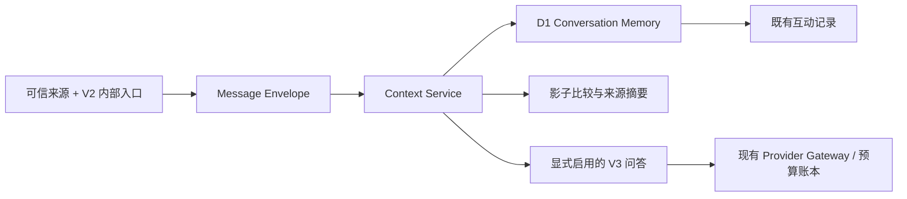

# 小墨鱼 D2：本地统一消息与上下文

日期：2026-11-28。承接 [统一架构](xiaomoyu-unified-memory-and-tools-architecture-20261128.zh-CN.md) 与 [D1 只读记忆](xiaomoyu-memory-readonly-d1-20261128.zh-CN.md)。

本轮提供独立 V2 消息适配、基于 D1 的 Context Service、无调用/无发送的影子比较，以及显式启用的普通问答执行接入。
默认仍为旧链路，不改变生产环境变量、现有入口、运行进程或 QQ 连接。
研究/编辑内部记忆保留 D1 的运营管理员边界，本轮不将其自动注入聊天。

## 模块与依赖



| 文件 | 责任 |
| --- | --- |
| [agent-message-envelope.mjs](../apps/api/src/agent-message-envelope.mjs) | 严格 V2 内部入站、原记录到消息封装的投影 |
| [agent-context-service.mjs](../apps/api/src/agent-context-service.mjs) | D1 历史、引用解析、限量、来源指纹、复核与影子比较 |
| [agent-context-conversation.mjs](../apps/api/src/agent-context-conversation.mjs) | 独立工作流版本和可信工厂开关，引用数据投影 |
| [agent-interaction-conversation.mjs](../apps/api/src/agent-interaction-conversation.mjs) | 在已有执行器内按版本接入，不另建模型或运行账本 |
| [platform-assistant.mjs](../apps/api/src/platform-assistant.mjs) | 将引用解析结果作为数据放在当前消息之前，保留原当前请求和工具控制判断 |

没有新增数据库迁移、长期消息库、消息汇总模型、索引或业务插件。
新 V2 入站仅复用旧互动表的 input_json；独立 messageV2 字段受版本和严格字段校验，不借用练习 context。

## 消息与引用

`agent-message-envelope-v2` 的身份和来源由已验证 origin 与持久化 interaction 推导：

- messageRef、原记录/字段/input 摘要、渠道远端事件引用与方向；
- agent、actor、channel、conversation 范围，群空间或私人空间，原会话 threadRef；
- 可信作者、入库时间、文字段、引用目标与原练习上下文。

已有消息没有保存原生 mention 段，本轮明确标记 `not-recorded`，不会依据文本里的 @ 或昵称伪造真实 mentions。
时间标明既有记录的创建时间，不冒充未记录的客户端发送时间。
QQ 仍使用旧 bot:group:user 会话，不合并群友、跨入口身份或共享话题。

新内部入站接受 `agent-message-input-v2`，引用仅携带结构化来源标识，不能提交“原文预览”来冒充源内容。
旧 Web/QQ HTTP 契约仍严格拒绝额外引用字段，QQ 原生 parseInbound 仍要求真实 @ 且拒绝 reply 段。
本轮没有给线上 QQ 开启引用、免 @ 或多人自动接话；真实渠道引用补取与展示需在后续渠道适配中单独验收。

引用只解析 D1 已授权的同机器人、渠道、用户、会话最近四轮数据，不去查询其他人的正文，也不追踪嵌套引用。

| 状态 | 含义 | 返回正文 |
| --- | --- | --- |
| resolved | 来源在当前授权窗口中且满足当前引用上下文限制 | 是，含原文摘要和来源 |
| missing | 无引用、目标不在窗口中或超过本次引用字节限量 | 否，附原因 |
| forbidden | 引用目标声称的范围与当前范围不同 | 否，不探测其他范围内容 |
| expired | 已超过本次引用语境的时间限量，或来源时间在当前采样时间之后 | 否 |

时间限量只限制显式引用语境；旧历史的保留/读取规则不因此被删除或改变，不把它宣称为 D4 遗忘/撤销机制。
无法解析时，将状态及缺少原文的说明交给模型，不用相似项目、显示文本或猜测填补。

## 有界上下文与权限复核

默认上限为历史 JSON 24,000 字节、单条引用内容 JSON 4,000 字节、完整上下文 JSON 64,000 字节、模型请求 JSON 160,000 字节。
显式引用语境最长 600 秒。服务配置可收紧，不能通过消息参数扩大这些上限。
这些是 UTF-8 字节限量，实际 Token、模型费用和阶段预算仍由现有 Provider Gateway 校验，并非将字节数宣称为精确 Token 数。

历史不足限量时保留原四轮结果；超限从最旧的完整问答轮开始排除，不截断单条文本，也不留下孤立的 assistant 回复。
返回 omittedTurns、historyBytes 和来源摘要，影子比较可看到确切差异。
影子比较是两次读取，不声称与并发任务状态变化构成全局原子快照；差异不触发自动迁移或隐式切换。

当前消息取自已保存输入，不使用客户端自报历史。上下文组装前后复用当前身份与 QQ 白名单校验；
再次使用时重读已选来源并核对指纹、范围、兼容投影及限量。权限被撤销或来源/有效状态变化时拒绝使用。
不自动退回旧读取来绕过校验。来源指纹包括消息、引用、所选历史记录与原始来源摘要。
这不是未来永久缓存的授权凭据，也没有取代最终渠道发送前现有的授权和投递规则。

引用是独立的数据消息，原当前请求仍保持原文；导航意图等确定性判断只读取当前请求。
引用中的“打开”“开启模式”“更改权限”等文字不会直接调用控制接口，也不会获得新的权限。
模型仍可能误解自然语言，所有模型工具意图继续受现有白名单、用途、能力、阶段和预算约束；本轮不以提示词代替这些硬边界。

## 本地问答接入与回退

可信代码通过工厂参数选择模式，不提供 HTTP、环境变量或模型可写开关：

```js
const memoryService = createAgentMemoryReadOnlyService({ pool, interactionService: service });
const contextService = createAgentContextService({ pool, interactionService: service, memoryService, repository });

// 单纯影子比较：没有模型调用、发送或数据库写入。
const comparison = await contextService.shadow({ origin, interactionId });

// 本地测试为独立 fixture 注册/激活 V3 manifest 后，显式创建执行器。
const execute = createAgentConversationExecutor({ repository, service, ports, practiceService, platformTools,
  contextMode: 'unified', contextService });
```

| 模式 | 新问答行为 |
| --- | --- |
| legacy，默认 | 原 V1/V2 工作流与输入，不注入新字段 |
| shadow | 先做只读比较，实际问答仍沿用旧输入与工作流 |
| unified | 使用工作流版本 3、输入版本 2，持久化不可变上下文来源投影 |

V3 不加入现有自动 bootstrap，测试只在隔离 fixture 中显式注册。原 runtime 工厂没有启用新模式。
V3 保持旧默认预算、现有模型配置、Provider Gateway、响应校验、工具与回执规则。
在 provider 调用前、生成返回后、工具执行前、checkpoint 前与结果返回前重新验证上下文；超限在 Provider Gateway 预留调用之前阻止。
关闭新模式后，新请求可走 legacy；已产生 V3 的运行明确拒绝被旧模式续跑，不伪装成 V1/V2 或重复生成。
V1/V2 既有运行不会被切换成 V3；本轮不扫描、续跑或重试真实旧任务。

## 验收和保留边界

[验收脚本](../scripts/verify-agent-context-local.mjs) 使用已存在的镜像和依赖，全部现有迁移应用到新建隔离 PostgreSQL，
不暴露主机端口、无公网网络。模型结果由离线适配器产生，但经过真实 Provider Gateway 和持久预算/回执链。
QQ 回归仅为合成事件与 fake gateway，不连接真实 QQ、不登录、不发送真实消息。

```powershell
node scripts/verify-agent-context-local.mjs --out-dir E:/CodexData/build/Right/agent-server-preflight/20261128/agent-context-d2-r3
```

输出目录必须不存在。输出 TAP、结构化结果、被测源码 SHA-256 和冻结源码差异；每次使用独立目录，不覆盖此前证据。
结束时仅按唯一任务标签清理新建临时容器，不操作现有服务。

本轮最终输出为 `agent-context-d2-r3/acceptance.json`：`AGENT_CONTEXT_D2_LOCAL_ACCEPTED`，54 项通过，零失败、零跳过。
检查 388 个既有冻结源码文件，其中仅上述两个显式接入文件发生预期变化；其余 386 个保持原摘要。
V3 问答、旧链路问答及生成中撤权测试共调用三次离线模型适配器，真实模型与真实 QQ 发送均为零。

覆盖内容：

1. V1 严格输入和练习 context 兼容；V2 作者、空间、会话和来源正确，无伪造 mentions。
2. 影子历史与旧读取一致；只读调用前后 public 下 297 张表内容指纹一致。
3. 引用四种状态、跨用户/会话/群隔离、来源内容篡改检查及读取期间撤权。
4. 本地统一问答持久化 V3 输入、正常回复、同一合成请求重入无第二次模型调用；显式 legacy 回退兼容。
5. 生成中撤权不产生可返回 checkpoint；上下文和请求限量在调用前生效；无工具执行记录。
6. D1 聊天/研究/编辑读取、原 Web/QQ 路由、普通问答、任务回执、QQ 合成渠道投递与平台助手回归。
7. 原冻结源码中只允许本轮两个显式接入文件有差异，QQ 原生连接、采样、恢复及登录相关代码保持原字节。

执行问答的测试允许新建合成任务的运行/Provider/预算/worker 账本发生预期变化，其他表保持指纹一致；
不能把这类正常执行测试描述为所有表零写入。只读影子测试与 D1 测试单独证明零持久变更。

本轮不改线上、重启现有服务、调整权限/预算/计划、清理登录/历史/旧锁、重试真实旧任务或修改论文工作。
两套论文保持关闭，对喷未实现。验收只证明离线本地行为，不代表真实 QQ 引用收发、真实模型理解或长期稳定性已通过。
