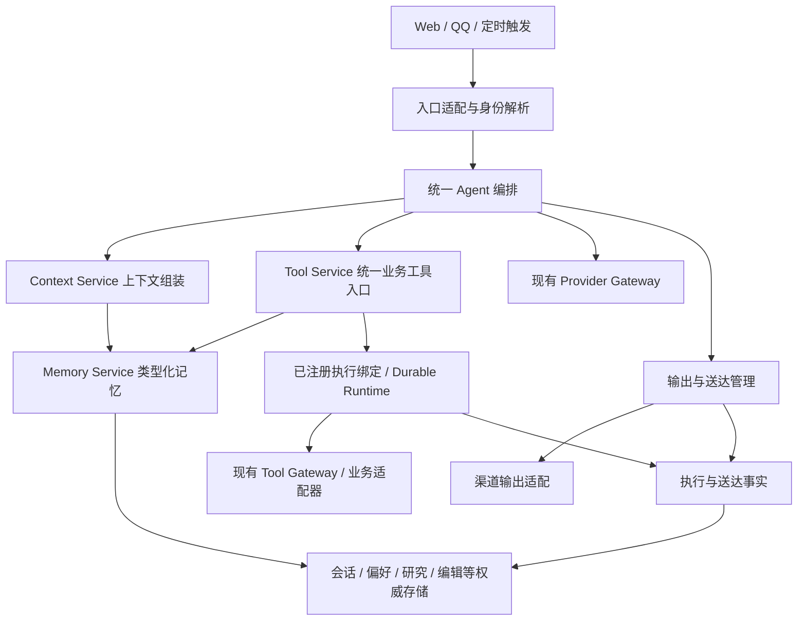

# 小墨鱼统一记忆、上下文与工具架构设计

日期：2026-11-28

状态：设计评审稿；没有实施或部署本稿中的新增接口、表或工作流。

代码评估基线：`f5ed1be06549945de1cd532fef91f1c8427edaa7`。

承接：[Agent 基座架构](xiaomoyu-agent-foundation-architecture.zh-CN.md)、[交互工作流](agent-interactions-20261120.zh-CN.md)、[插件机制](agent-plugin-admin-20261121.zh-CN.md)。

## 1. 设计结论

小墨鱼保持一个 Agent 身份，Web、QQ、定时任务是入口，研究、写作、普通问答、娱乐是能力或表达模式。
所有功能复用统一的身份、上下文、记忆、工具、权限、预算与回执机制。

统一的对象是契约、治理与生命周期。聊天、研究证据、编辑历史、任务执行仍各有一个明确的权威存储。
娱乐功能只增加玩法规则与必要状态，不另建人格、模型凭据、长期记忆、工具调用和任务恢复体系。

本稿采用模块化单体：新增公共服务先部署在已有 API／执行器进程内，复用 PostgreSQL。
QQ 网关、QQ worker 和 guardian 保持独立的连接与恢复边界。本阶段不引入 Redis、向量数据库或新微服务。

## 2. 已有实现与实际缺口

以下是基线代码评估，不能据此声称全部目标能力已在生产启用。

| 领域 | 已有实现 | 待完善部分 |
| --- | --- | --- |
| 身份与治理 | Agent 账号、人格版本、渠道参与者、能力授权、策略、预算和计划 | 统一传递用户、空间、目的与权限上下文 |
| 入口与对话 | `agent-interactions` 接入 Web／托管 QQ，使用中央 Agent 模型和执行器 | 结构化消息、共享空间、引用解析与统一上下文组装 |
| 运行时 | Run／Stage／Action／Event、租约、幂等、持久回执、Provider Gateway、Tool Gateway | 给对话中的每个工具意图明确的受控执行绑定 |
| 工具注册 | 插件描述、后台工具契约、任务类型与工作流注册 | 对话任务提交、平台查询、界面动作仍有不同的上层分支 |
| 互动记忆 | 按 Agent／渠道／提问者／会话读取最近四条已完成主交互及相关结果 | 多人话题、引用、偏好、撤销、统一检索和管理 |
| 研究记忆 | `tool_research_*` 资料与版本、证据，以及 Agent 工具产物的来源绑定 | 对话及其他能力经公共记忆服务按权限复用 |
| 编辑记忆 | 编辑事件、主题投影、选题冷却、来源版本与主张关系 | 接入统一访问、生命周期与可观测界面 |
| QQ 连接 | 独立渠道插件、后台原生采样、登录与有界 guardian 恢复 | 新业务仅扩展消息契约和路由，不进入连接控制面 |

评估依据：

- [互动历史](../apps/api/src/agent-interaction-repository.mjs)、[对话执行器](../apps/api/src/agent-interaction-conversation.mjs)。
- [互动工具入口](../apps/api/src/agent-interaction-service.mjs)、[平台工具](../apps/api/src/platform-agent-tools.mjs)、[插件宿主](../apps/api/src/agent-plugin-host.mjs)。
- [运行时服务](../apps/api/src/agent-runtime-services.mjs)、[工具网关](../apps/api/src/agent-tool-gateway.mjs)、[运行策略](../apps/api/src/agent-runtime-policy-service.mjs)。
- [研究证据存储](../apps/api/src/agent-research-evidence-repository.mjs)、[编辑记忆存储](../apps/api/src/agent-editorial-memory-repository.mjs)。
- [QQ 消息准入](../apps/qq-channel/src/config.mjs)、[QQ／Agent 桥接](../apps/qq-channel/src/agent-bridge.mjs)、[QQ 渠道运行时](../apps/qq-channel/src/plugins/qq/runtime.mjs)。

特别需要补齐的两个约束：

1. 当前 QQ 入站只接受带真实 @ 的文字消息，并拒绝 reply 等段类型；免 @ 与引用理解需要版本化的入口契约，不能只改提示词。
2. 当前运行策略要求 Stage 声明的能力与 Action 能力一致。工具统一后仍必须满足此约束，不能把各种工具直接塞进仅授权模型生成的 respond 阶段。

## 3. 总体结构与依赖方向

权限、预算、审计、取消和版本检查贯穿入口、上下文、执行、发送阶段；图中不为这些横切职责新增一套业务实现。
图中的箭头表示服务依赖或信息流，不表示直接数据库写权限。

### 模块职责

| 模块 | 唯一职责 | 不承担的职责 |
| --- | --- | --- |
| Channel Adapter | 验证渠道来源，转换消息与引用标识，持久缓冲与投递，回传送达事实 | 维护另一套人格／长期记忆／模型循环 |
| Session Service | 维护空间、话题、参与者、模式实例及到期状态 | 决定工具授权或把参与状态变成长期用户事实 |
| Agent Orchestrator | 处理当前请求、选择模式、推进有界对话／任务步骤 | 直接访问渠道凭据或随意调用外部 API |
| Context Service | 为一次执行生成有权限、有预算、可解释的上下文投影 | 保存第二份事实或凭相关性扩大可见范围 |
| Memory Service | 类型化读写、来源、作用域、有效期、失效与检索 | 接管任务执行账本、保存无来源的自由文本事实 |
| Tool Service | 工具目录、统一调用契约、实际准入、执行分派与回执 | 自建另一套密钥、预算或绕过运行时策略 |
| Domain Services | 研究、编辑、学习、娱乐各自的业务规则与权威数据 | 跨域直接写表或重新实现公共治理 |
| Output Service | 把结果投影为回复／任务卡／文章，处理发送状态与发送前复核 | 把草稿、排队或未知发送状态记为已送达 |

QQ 登录、令牌、原生连接和 guardian 属于运维控制面；娱乐模型不获得其调用能力。
业务超时、记忆故障、工具失败不改变原生登录判断，不触发 QQ 重启。

## 4. 统一身份、空间、话题与执行上下文

公共执行上下文 `AgentExecutionContextV2` 拟包含：

| 字段 | 来源与意义 |
| --- | --- |
| `agentId` | 唯一 Agent 身份；小墨鱼的模式切换不创建另一个 Agent |
| `actorPrincipalRef` | 当前发起人的可信账号或渠道身份绑定，来自服务端 |
| `channelBindingRef` | 已验证的 Web 会话或 QQ 机器人绑定 |
| `spaceRef` | 私人空间或受控群空间 |
| `threadRef` | 当前问答、研究话题或共享娱乐会话 |
| `requestRef` / `runRef` | 追踪和幂等依据 |
| `purpose` / `modeBinding` | 普通对话、研究、编辑、娱乐等用途与已注册模式版本 |
| `policyRevision` / `memoryRevision` | 发现权限或记忆撤销后复核和阻止旧输出 |
| `deadline` / `signal` / `budgetRef` | 统一超时、取消和成本归属 |

这些字段由入口认证、会话解析与服务端策略产生，模型和普通请求参数不能自行指定权限身份。

### 范围规则

- Agent 身份相同不代表所有记忆都公开。检索和输出均按用户、群、话题、用途与来源权限约束。
- QQ 的旧 `bot:group:user` 会话标识及请求 ID 保留；新增共享话题通过服务端映射关联，不重写旧标识。
- Web／QQ 账号关联必须有可信绑定；同名或相同昵称不建立跨入口身份关系。
- 群友参与娱乐只授予相应互动资格，不继承其他参与者的工具或研究权限。
- 现有白名单继续作为既有入口边界；新的群娱乐准入作为单独、显式的用途策略配置，不能顺带放宽普通问答和研究准入。
- 跨群内容必须另有明确授权；普通群聊引用不能充当跨群读取凭据。

话题路由先使用可信消息标识、当前活动会话和有限共享语境选择候选，再进行用途准入和完整上下文组装。
插件可以提供接话判定规则，Context Service 只负责按已确定的范围取数。
如果需要模型辅助分类，也必须经过现有 Provider Gateway 和预算；分类结果不能授予权限。
明确的普通问答、研究或管理请求继续进入相应入口，娱乐自动接话仅匹配当前活动话题。

## 5. 统一消息与引用契约

`AgentMessageEnvelopeV2` 是输入／输出消息的公共投影，拟包含：

`messageRef`、`sourceRef`、`spaceRef`、`threadRef`、可信作者引用、消息时间、文字／媒体段、真实 mentions、`replyToRef`、来源版本及解析状态。

规则：

1. 原始渠道消息以渠道绑定、空间、远端消息 ID、方向等命名空间定位；由服务端建立稳定内部引用，不能单靠昵称或一段文字匹配。
2. 引用关系必须能定位原消息。引用解析结果明确为 `resolved / missing / forbidden / expired`，预览文字不冒充已核对原文。
3. 补取 QQ 引用通过已有渠道的受控读取能力完成；沿用既有连接，只读当前授权空间，限制层数、字节数与请求预算。
4. 开启、退出、遗忘等指令按当前发言和身份判定；被引用内容、历史和工具返回值作为数据处理。
5. 内部消息结构保留完整引用关系；QQ 等输出适配器负责原生引用展示。
6. 原文保留期、撤销和访问限制沿引用生效，不能靠复制引用快照绕过遗忘或过期。

原内容保持一个明确的权威来源。第一阶段以引用适配现有 interaction 和 QQ 记录，不批量复制全部历史。
QQ 在中央 API 暂时不可用时可保留持久传输缓冲；它是可靠送达设施，不成为第二套长期业务记忆。

现有 `input.context` 表示练习批次／题目，且当前 QQ 契约拒绝该字段。
V2 必须给消息结构和服务端上下文使用独立的版本化字段，不能挪用练习 context 或放宽旧校验来传引用。
旧 Web 客户端提交的 history 只作为带来源标记的兼容输入，不能冒充服务端原始消息或产生长期事实与权限。

## 6. 类型化记忆与数据归属

| 类型 | 权威来源 | 可使用范围与生命周期 |
| --- | --- | --- |
| 身份与人格 | 现有 Agent／行为配置及版本 | 按运营授权提供；模式覆盖只影响当前范围的表达 |
| 会话原文与引用 | Conversation Store 对现有记录的适配及新增公共消息记录 | 私人／群／话题范围；区分上下文缓冲与正式互动 |
| 会话摘要 | 引用源消息的可重建投影 | 源消息撤销或变更后失效，不成为独立事实来源 |
| 用户偏好 | 统一偏好存储，记录本人明确表达及来源 | 按本人／群／已绑定入口范围应用，支持纠正与撤销 |
| 娱乐梗 | 统一会话记忆的 joke 类型 | 标明玩笑、人物和话题范围，有到期时间；不得升级成用户事实 |
| 研究资料与结论 | 现有 `tool_research_*`、资料版本与证据绑定 | 按来源权限、核验状态和时效使用，保留未知与冲突 |
| 编辑经验 | 现有编辑事件、主题投影、来源与主张关系 | 为编辑用途提供去重和冷却依据，不影响娱乐人物评价 |
| 执行与送达经历 | 现有 Run／Stage／Action／工具及渠道回执 | 回答任务状态和“已做什么”，与内容事实分开 |

已有研究、编辑和运行存储继续拥有原数据，不迁入一个 `text + embedding` 万能表。
必要的公共引用目录只保存类型、来源引用、作用域、版本、到期与撤销元数据，不建立第二份可独立改写的事实正文。

### 公共记录约束

每份可召回内容具备：类型、权威来源引用、所有者／空间、用途与可见范围、来源版本、有效时间、状态和派生关系。
全文／向量索引是可重建的候选引用索引；先按范围约束召回，再对原记录执行当前权限和版本检查。
缓存键必须包含相关身份、空间、用途和策略／记忆版本，不能跨用户复用私人上下文。

工具成功只证明调用完成。研究结论的支持状态仍由证据与核验规则产生。
模型生成的摘要或判断是候选派生内容，不能自行标记为已核验事实。
“用户要求提供证据链接”属于任务输出要求，不是项目属性；“你输了”属于娱乐表达，不是研究结论。

### 首期保留策略

- 原有历史、账本和编辑冷却规则保持原样，不以新设计自动清理旧记录。
- 旧私人对话先保持最近四条历史的行为，通过适配器接入。
- 新的共享上下文可先配置为最近 30 条且最长 10 分钟，仅在授权活动空间启用。
- 新娱乐会话原文与梗可配置为 7 天；普通旁观聊天只作短时语境。
- 明确偏好按本人授权范围持续保存，直至修改、撤销或适用保留策略要求失效。
- 这些是新类型的建议初始值，必须以版本化策略配置，不写死在每个插件里。

## 7. 公共记忆接口与写入流程

拟新增的逻辑接口如下，名称不是已经存在的可调用能力：

| 接口 | 职责 |
| --- | --- |
| `read / search` | 在可信执行上下文内读取和检索类型化记忆 |
| `propose` | 接收带来源的记忆候选；服务端校验后再提交 |
| `correct / revoke / forget` | 区分纠正、失效和停止召回，产生版本与传播事件 |
| `explain` | 展示一条记忆为何存在、来自哪里、谁可见、何时过期 |
| `snapshot` | 为 Context Service 返回有限、可追踪、可复核的读取投影 |

领域服务直接写自己的权威记录，再在同一事务写入可靠事件；投影消费者按事件 ID 幂等更新摘要和索引。
已发送的内容、已发布的文章、已核验的证据等采用各自已有事实事件，避免模型在回复结束时自由改写所有记忆。
明确偏好和遗忘请求优先由确定性的公共控制流程处理；一般摘要和梗提炼可异步进行，失败不阻塞回复。

公共层提供统一管理页面：按类型、来源、用户、空间、话题、到期和状态查询、解释、纠正或撤销。
管理页、自然语言管理入口和插件都调用相同服务；权限校验在服务端，界面筛选不构成授权。

## 8. 上下文组装与模型边界

Context Service 的固定流程：

1. 读取可信身份、当前准入、停止状态和用途策略。
2. 解析当前消息及有权限的引用，不凭关键词推断作者。
3. 获取当前话题最近对话、相关偏好、摘要与必要证据。
4. 按用途、有效期、来源可信度和 token 预算裁剪。
5. 返回当前可见工具集，以及上下文引用、版本和缺失项。
6. 执行前及发送前复核权限、活动状态与相关记忆版本。

人格、治理规则、当前用户请求、任务约束、原文、摘要、工具回执分区组装；历史或引用不能覆盖治理规则。
任务约束继续区分项目筛选条件、偏好与回答要求，避免重现 GitHub 搜索中的语义混淆。

自动取上下文是受控服务读取，不要求先调用模型才能决定是否有权读取。
模型主动要求搜索或修改记忆时，则经统一 Tool Service 调用同一 Memory Service。
两种路径共用授权、来源和生命周期规则；不会形成两个不同版本的记忆。

新的上下文快照尽量保存源记录引用、版本、选择依据和预算，不把全部原文重复复制进多个不可变运行记录。
已有冻结运行输入保持历史事实；实现时不得追溯修改旧 Run。

## 9. 统一工具目录、调用契约与执行落点

### 目录与权限

插件、平台功能和记忆能力统一注册版本化工具描述、参数／结果 schema、风险、效果类别、执行绑定和可用条件。
MCP 对外目录可做受控投影；可被发现不等于已经获得 Agent 内部执行权限。

模型看到的是当前身份、渠道、用途、插件启用状态、授权、运行预算共同约束后的工具集合。
真正执行时再验证一次；用户 ID、所有者、空间和能力绑定不从模型参数中采信。
记忆命中、人格切换、参与群聊或插件安装都不能产生新授权。

插件关闭与数据访问撤销分开处理：关闭停止新执行及该模式的自动上下文注入，
此前已经公开或仍授权的文章、任务回执继续按原数据权限读取。历史存在不重新授予工具执行权。

### 调用与回执

逻辑调用包含：`invocationRef`、工具及版本、可信上下文引用、已校验参数、幂等键、截止时间和预算引用。

外部结果至少区分：

- `completed`：已取得相应结果与回执；
- `accepted`：已持久接收任务，携带 taskRef，尚未完成；
- `waiting`：等待已有执行条件或既有确认策略；
- `failed`：已知失败；
- `uncertain`：存在副作用或发送结果未知，必须保留水位。

该统一结果是兼容投影，不能直接覆盖现有数据库枚举或改变旧任务恢复规则。
界面导航请求还需要客户端确认结果；任务已保存、请求已发出、用户已看到分别表示不同事实。

### 保留 Stage 与能力一致性

现有 `policyService.decide` 要求 Stage capability 与 Action capability 相同。
因此采用以下执行方式：

1. 模型生成阶段只产生回复候选或工具意图，不获得任意工具权限。
2. Tool Service 将意图绑定到目录中已注册、版本固定的工具执行工作流／单元。
3. 实际工具执行在声明了对应能力的 tool 阶段内，通过现有 Tool Gateway 与 Policy 完成。
4. 快查询可以在现有执行进程内推进这一单元；长任务交给持久执行器。两者共用契约和回执。
5. 通过请求／运行／阶段／动作引用建立父子关系。上下级预算明确归属，实际调用只结算一次。

新的对话编排版本应把 context、模型意图、受控工具执行和回复检查分开推进，有明确的步骤上限与检查点。
不能仅换一个工具门面，仍在 provider-only 的 respond 阶段直接执行所有工具；也不能把 Stage 的能力校验放宽为通配符。
工具请求的协调记录只保存关联和调度状态；实际外部调用、动作与费用继续以现有账本为准。

## 10. 回复、送达、遗忘与可靠性

### 生成和送达

统一消息状态区分已生成、待发送、发送中、已被渠道确认和未知。
QQ 的发送事实仍以现有渠道记录中的远端消息回执为准；Web 使用对应渠道的交付事实，用户是否阅读另行表示。
回答“已经说过／完成过什么”时引用相应回执，不能只检查 Agent 交互是否 completed。

入站消息、回复意图、投递分别使用稳定幂等键。进程重启恢复未完成的新流程时保留发送水位，
不把外部投递当成天然恰好一次，不因超时盲目重发，也不重试既有旧任务。

### 遗忘与撤销

1. 验证当前请求者对目标记忆的管理范围，记录撤销并增加相关版本。
2. 立即阻止后续上下文读取，再幂等传播到摘要、梗、缓存和索引。
3. 开始发送前复核版本；受撤销影响的未发送回复标为不再投递，保留审计，不自动重新执行旧任务。
4. 已经发出或结果未知的内容遵循渠道事实与现有处理规则，不假定能够撤回。
5. 统一界面区分“停止召回”“原内容已清理”“备份仍在保留期”等真实状态。

已有研究、编辑及运行审计有不可变约束，不能为实现遗忘而删除或伪造旧账本。
对这些旧记录采用治理层撤销和读取屏蔽；真正的内容删除按权威数据域和备份保留规则单独处理，
不能把逻辑失效宣称为彻底物理删除，也不能让索引重建把已撤销内容重新带回模型上下文。

## 11. 插件与娱乐模式如何接入

对喷插件负责：启停意图、自然接话判断、参与规则、模式状态、表达风格和结束条件。
Session Service 提供共享话题与参与状态；Context Service 提供引用和前文；Memory Service 管理偏好和梗；
Tool Service 提供可用能力；模型与消息收发继续沿用公共链路。

典型流程：

`一句话开场 → 身份与用途准入 → 建立模式会话 → 普通发言／引用进入话题判断 → 公共上下文 → 模型生成 → 版本与权限复核 → 原生引用回复 → 回执归档。`

普通旁观群聊只在活动空间内作有限短时语境，不自动变成长久人物记忆。
停嘴、退出和遗忘走公共控制流程，不能依赖模型是否愿意服从角色设定。

现有插件 v1 manifest 使用严格字段检查，新增上下文／记忆声明必须升级宿主契约，或通过受控的旁路注册表适配。
保留旧插件版本的适配器，不能直接向 v1 随意加字段后要求所有插件同时升级。
新插件通过有限服务接口访问公共层；当前插件仍是仓库内受信代码，这种模块接口不是恶意代码沙箱。

## 12. 故障隔离、资源与可观测性

| 情况 | 业务行为 | QQ 连接行为 |
| --- | --- | --- |
| 可选摘要／索引不可用 | 在必需权限和控制状态仍可验证时，使用有限原文；不承诺完整记忆 | 继续独立采样和收发 |
| 权限、停止或撤销状态不可验证 | 暂停相关生成／发送，保留请求 | 不改登录判断 |
| 工具／模型超时 | 返回或记录对应失败／等待／未知，不伪造结果 | 不触发 native restart |
| 中央 API 暂时不可用 | 渠道按现有持久缓冲、预算和重试规则等待 | 登录监测独立运行 |
| 原生登录失效 | 按原生证据和既有有界 guardian 策略处理 | 保留登录卷、计数及扫码入口 |

统一治理不要求所有业务共用一个无差别排队通道。沿用当前消息／任务分离基础，按群、用户、模式和任务类别限制并发、排队及成本。
娱乐不能占满研究、普通问答和系统健康检查资源；原始采样、收手和取消不等待长模型调用。
前台轻量查询不能隐式变成无限后台扫描；摘要、索引维护也有预算、幂等和停止条件。

至少观测：端到端 requestRef、上下文来源与版本、记忆命中／排除原因、工具授权决策、调用与预算归属、
生成与投递状态、队列延迟、撤销传播、插件故障，以及独立的 QQ 原生健康。日志不输出凭据或完整私人提示词。

## 13. 兼容迁移路线与验收门槛

| 阶段 | 允许的变更 | 进入下一阶段的条件 |
| --- | --- | --- |
| D0 设计冻结 | 本稿、契约说明与资产映射 | 模块责任、来源权威、作用域和执行绑定可评审；无业务变更 |
| D1 记忆访问适配 | 给原互动、研究、编辑存储提供统一只读接口 | 旧结果和权限一致；无写回、无历史任务或 provider 调用 |
| D2 消息与上下文 | 版本化结构化消息、空间／话题、引用和 Context Service | 旧 API 与旧会话不变；引用来源正确、跨群隔离、预算有界 |
| D3 工具入口收拢 | 注册映射与受控执行绑定，适配旧工具名和返回值 | Stage 能力匹配、冻结与当前授权均验证；无重复记账或副作用 |
| D4 记忆写入与管理 | 偏好、摘要、撤销传播、统一管理界面 | 来源、失效、并发遗忘、缓存重建及在途发送检查通过 |
| D5 娱乐能力 | 复用上述服务注册自然斗嘴模式 | 开启／接话／引用／收手、额度、并发和回归通过 |

每阶段独立评审、可关闭新入口、可回到旧接口；已经产生的新数据保留兼容读取，不能靠恢复旧数据库回退。
适配期间的历史索引如需建立，仅做受权限约束的读取与可重建投影，不重新运行旧任务、调用模型或投递旧 outbox。
现有预算、计划、旧锁、授权和部署身份保持不变。论文存储只登记已有边界，两套论文仍关闭，不注册新的可执行论文能力。
任何部署、服务重启或故障演练都不属于本设计稿的执行范围。

### 必须覆盖的验收场景

1. 原 Web／QQ 问答、GitHub 搜索和任务回执结果保持兼容；项目条件与回答要求不混入彼此的事实记忆。
2. 相同昵称、不同用户或不同群不会串记忆；跨入口身份未经绑定不合并。
3. 多人共享话题不会合并工具权限，引用不会触发控制指令；引用缺失／禁止／过期有明确状态。
4. 模型生成但未送达、任务排队、工具已接受和实际完成分别呈现。
5. 偏好纠正、来源撤销、索引重建及生成中遗忘不会恢复被禁止召回的内容。
6. 原编辑去重／冷却和研究版本／证据关系保持一致，旧不可变账本不改写。
7. 每个工具调用的用户、空间、用途、能力、Stage、预算和回执可追踪；发现工具不等于获得权限。
8. 断网、进程重启、租约过期和未知投递不会盲目重复外部副作用；旧任务不重放。
9. 娱乐洪峰、模型超时或记忆不可用不影响原生 QQ 采样、既有登录数据与恢复计数。
10. 插件关闭后不再执行其工具或注入模式上下文；原已授权历史仍可读取。权限撤销与论文关闭不被缓存、旧快照或记忆检索绕过。

## 14. 本稿固定的架构决策

- 复用现有公共身份、Policy、Provider／Tool Gateway 和 Durable Runtime。
- 公共 Context／Memory／Tool 服务分工明确，业务插件调用它们；统一管理与业务访问遵循同一授权。
- 原始内容与事实各有权威存储，摘要和检索索引可重建，业务会话状态与长期记忆分开。
- 工具目录收拢与实际执行绑定一起设计，保留 Stage 能力一致性和当前权限复核。
- 消息协议、插件契约、工作流、记忆策略和上下文均版本化，旧链路通过适配逐步承接。
- QQ 连接与恢复保持独立，业务错误不扩大为登录故障；新功能不自动激活关闭能力。
- 优先完成公共契约和旧功能兼容，再实现娱乐功能；本轮只交付设计。
